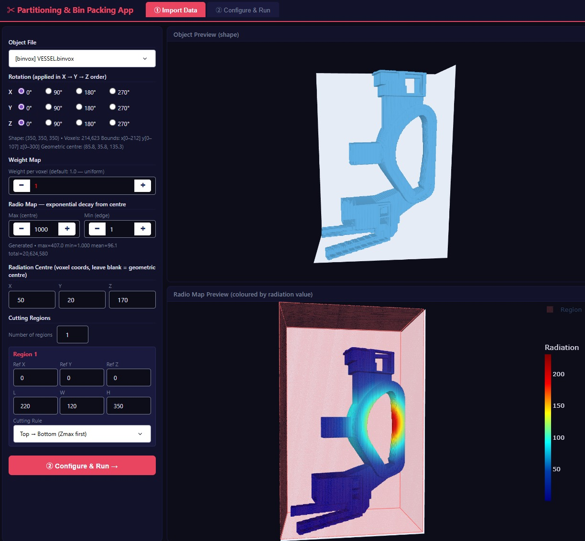
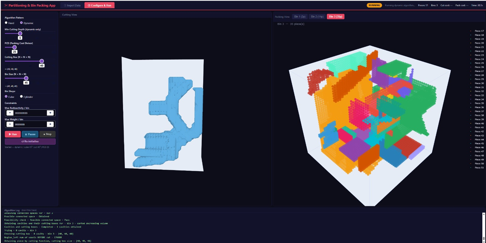

# Partitioning & Bin Packing Decision Support Application

## Demo / Portfolio Showcase

This page presents the interface and capabilities of a research prototype for **3D voxel-based partitioning and bin packing optimisation** of irregularly shaped components.

It is a visual showcase, rather than a downloadable software release. The underlying source code, research datasets, and internal configuration remain private. This page does not provide a public executable or a hosted interactive demo.

## Overview

The application brings together geometric processing, constrained optimisation, and interactive visualisation in a browser-based workflow. It supports:

- Partitioning voxel models into smaller pieces while considering geometric, cutting-accessibility, weight, and radioactivity constraints.
- Packing pieces into cuboid or cylindrical containers under geometric, packing-accessibility, weight, and radioactivity constraints.
- Improving an initial packing solution using GRASP metaheuristic optimisation within a configurable time budget.
- Visualising cutting progress, container layouts, and optimisation results.

## Demonstrated Workflow

### 1. Model Preview and Configuration

The interface provides a 3D preview of the selected voxel model, a configurable radioactivity map, and cutting-region controls. These views help users inspect the geometry and proposed configuration before running the computation.

### 2. Cutting and Packing

Users configure the cutting approach, container geometry, and constraints through the interface. During execution, the application displays cutting progress, packed pieces, container counts, elapsed time, and algorithm status. Individual containers can be selected for inspection.

### 3. Optimisation and Results

The optimisation stage starts from the initial packing solution and searches for improved arrangements. The interface compares baseline and best-result metrics, allowing users to inspect changes in container use and packing cost.

## Technical Highlights

- **Scientific computing:** Python-based voxel geometry, constrained partitioning, and bin packing.
- **Optimisation:** Constructive methods and GRASP-based packing improvement.
- **Interactive interface:** Dash and Plotly for parameter configuration and 3D visualisation.
- **Computation:** GPU-accelerated geometric operations where supported by the execution environment.
- **Software engineering:** Modular components, Git version control, documented workflows, and automated checks.
- **Validation:** Test coverage includes application integration, packing correctness, execution controls, and CPU/GPU computation equivalence checks.

These describe capabilities of the private implementation; no source code or test suite is distributed through this showcase.

## Scope and Availability

This is a research prototype presented for portfolio and demonstration purposes. The screenshots illustrate its interface and workflow; they do not establish suitability for operational nuclear-decommissioning decisions or constitute a performance benchmark.

No installation instructions, source downloads, credentials, or private datasets are provided. Any separately arranged demonstration is subject to the availability of suitable demonstration data and permission to share the relevant material.

## Acknowledgements

This work has been part-funded by the **EPSRC Energy Programme** [grant number EP/W006839/1], with research collaboration involving the **University of Leeds** and **UK Atomic Energy Authority (UKAEA/RACE)**.

## Rights and Permissions

This showcase does not offer the underlying software or research data under an open-source licence. Publication of this page does not grant a licence to the private implementation or datasets. Any reuse of demonstration materials beyond permissions already applicable requires permission from the relevant rights holder.

